# 旅行打卡地图足迹

> 移动端风格的「地图 + 时间线 + 统计 + 心愿 + 精选分享」个人足迹应用，支持中英双语。桌面浏览器下居中显示带手机边框的「真机」视图。

## 在线访问

**https://travel-footprint-d8em6aa6331d820-1495478913.tcloudbaseapp.com/**

> 免登录可体验游客模式；手机浏览器打开效果最佳。

[](https://travel-footprint-d8em6aa6331d820-1495478913.tcloudbaseapp.com/)
[](https://react.dev)
[](https://vite.dev)
[](https://www.typescriptlang.org)
[](https://tailwindcss.com)
[](https://cloudbase.net)
[](LICENSE)

## 核心亮点

- **:map: 地图足迹**：交互式地图按分类（风景/美食/人文/城市/亲子/户外）与状态（已打卡/心愿）筛选，大头针着色，点击进详情。
- **:pushpin: 打卡与心愿**：新增/编辑/删除打卡；心愿清单可一键「完成此心愿」原地转为已打卡，不打扰其它页面。
- **:calendar_spiral: 时间线 + 统计**：按月回顾足迹；环形分类图、分类分布条、年度柱状图、省份点亮进度。
- **:globe_with_meridians: 中英双语**：「我的」页一键切换中/英，全部界面文案经 i18n 抽取，无硬编码中文。
- **:baby: 游客模式与精选分享**：未登录用本机 localStorage 体验，登录后数据写入云端并按用户隔离（RLS）；公开打卡可生成 `/share/:publicId` 免登录分享页。

## 效果预览

全部为实机截图（手机视口实录）。

### 游客模式（中文）

打开链接即可体验，无需注册。地图支持路线连线、箭头与路线动画：

| 地图主页 | 路线动画 | 时间线 |
|---|---|---|
| 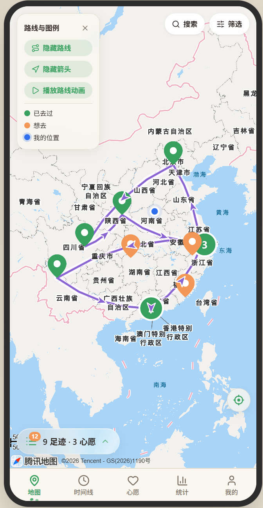 | 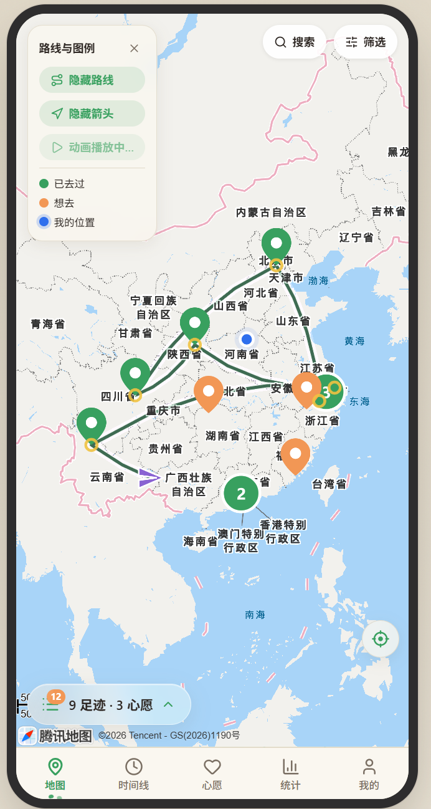 | 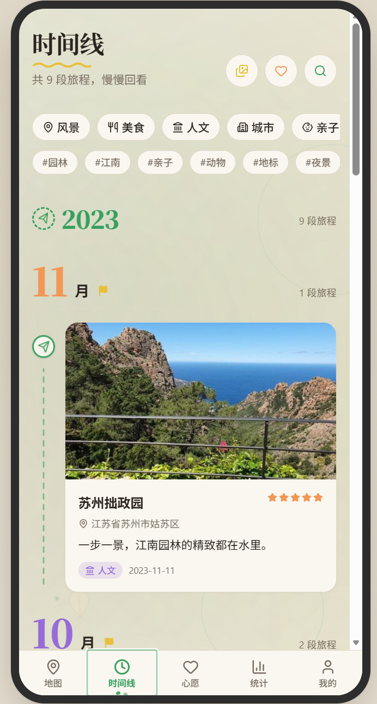 |

| 心愿 & 点亮 | 旅行年鉴 | 我的 |
|---|---|---|
| 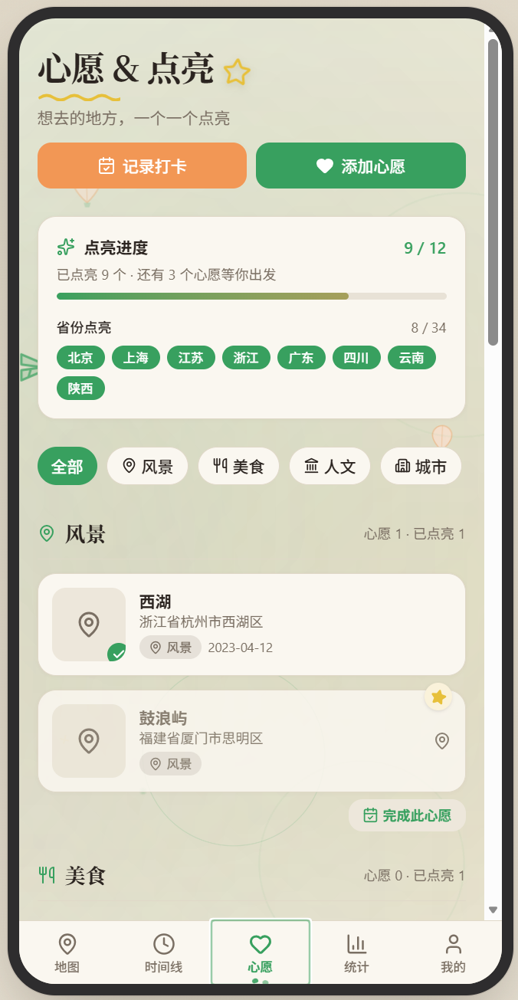 | 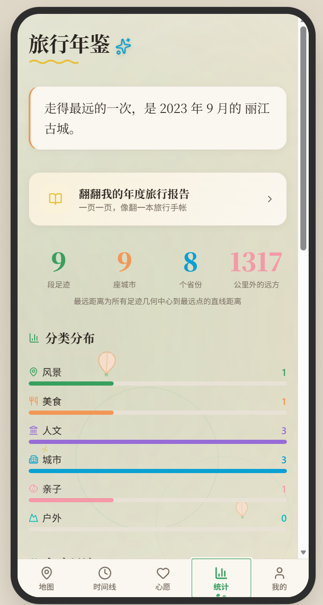 | 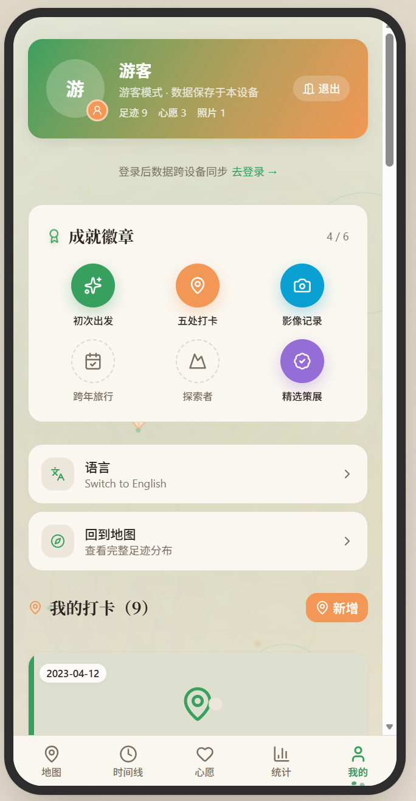 |

| 打卡详情 |
|---|
| 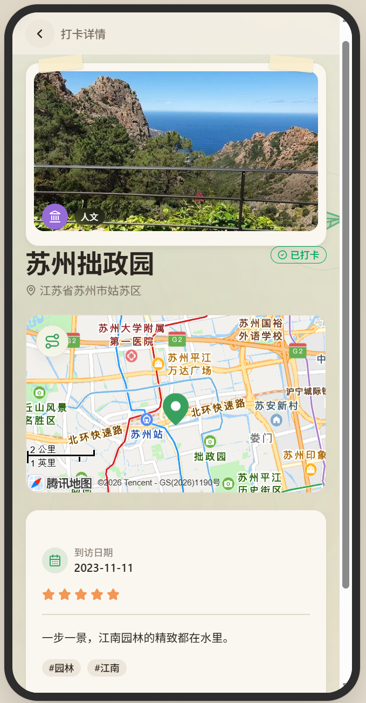 |

### 邮箱验证码登录（真实账号）

登录后数据写入云端，跨设备同步；新账号从零开始记录：

| 登录页 | 邮箱验证码 | 登录成功 |
|---|---|---|
| 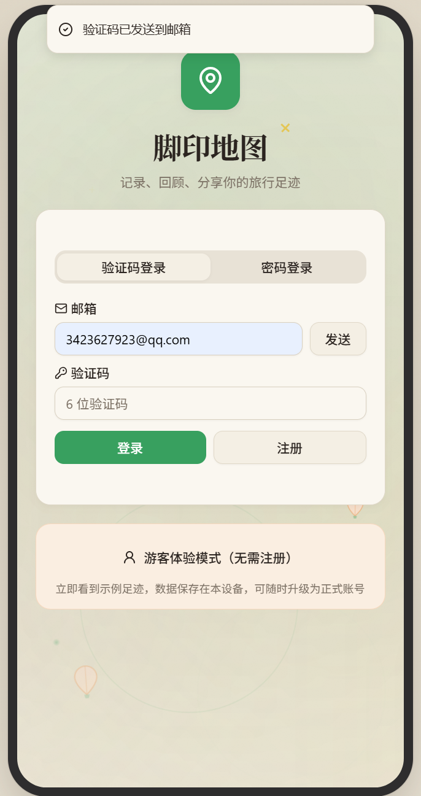 |  | 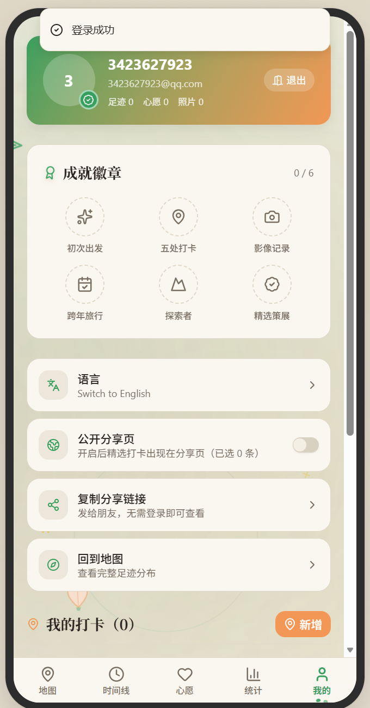 |

| 地图（空） | 时间线（空） | 心愿（空） |
|---|---|---|
| 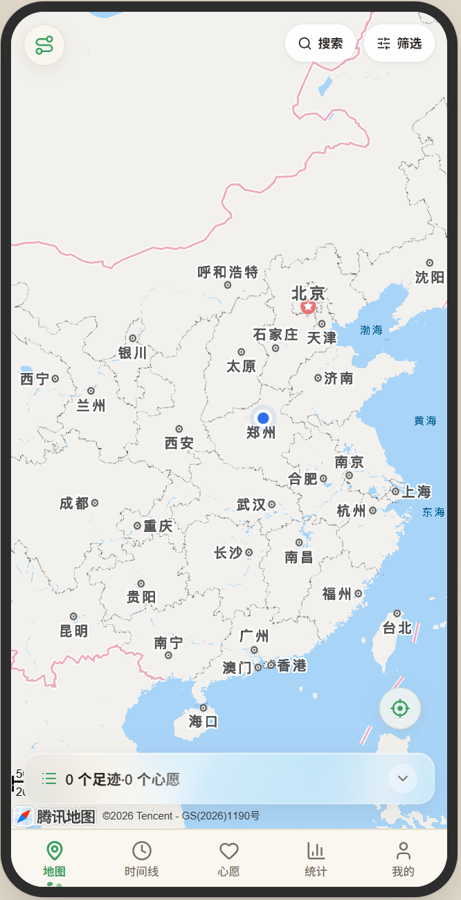 | 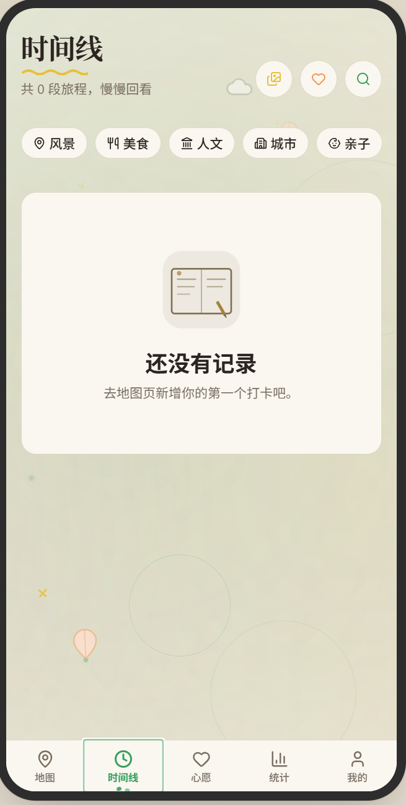 | 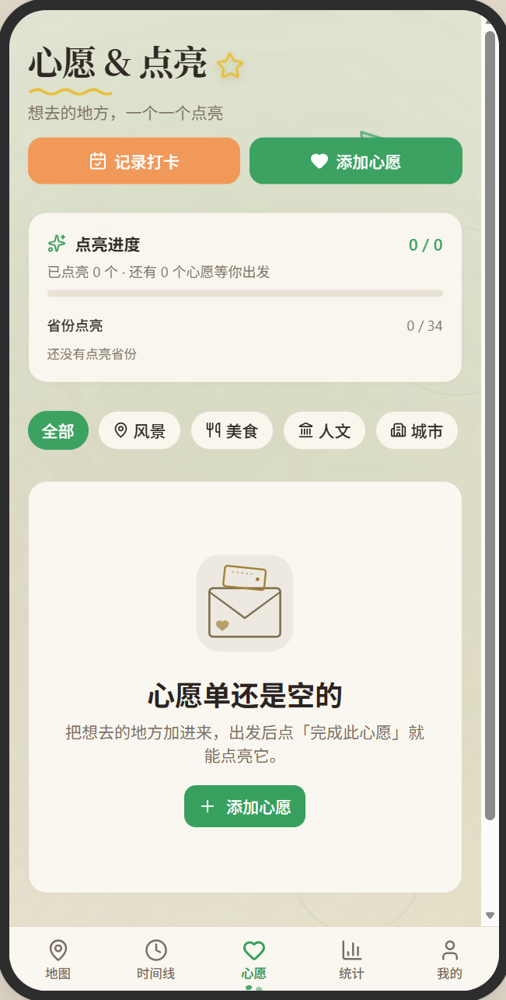 |

| 统计（空） | 我的 |
|---|---|
| 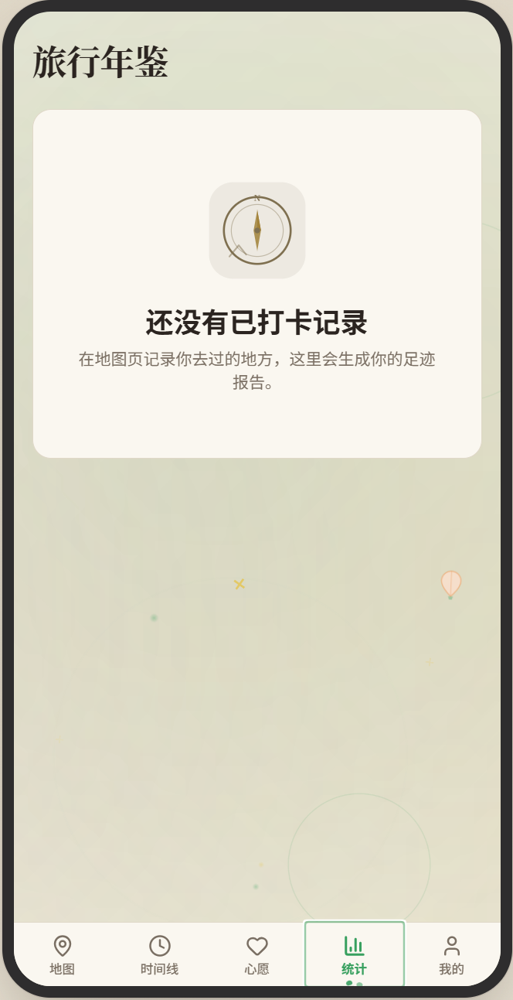 | 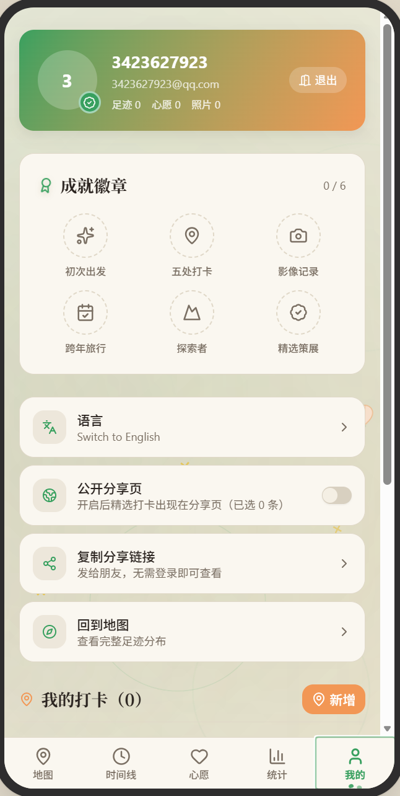 |

### 游客模式（English）

「我的」页一键切换中/英，即时生效：

| Map | Timeline | Wishes |
|---|---|---|
| 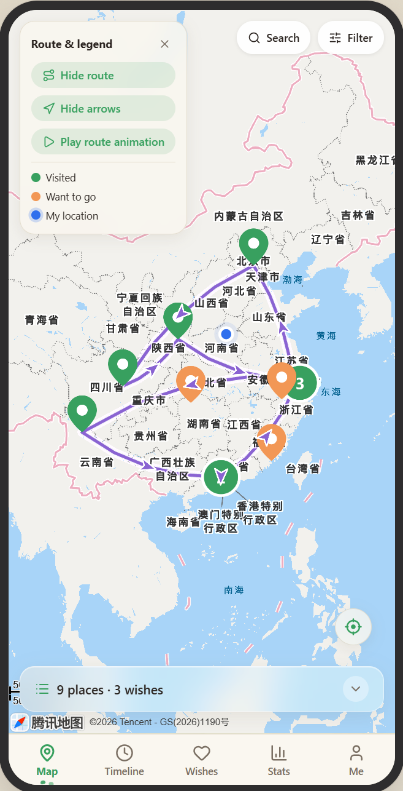 | 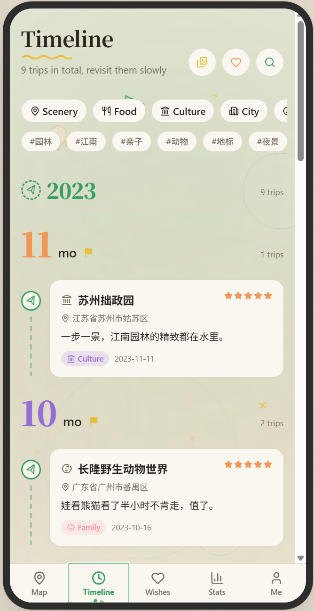 | 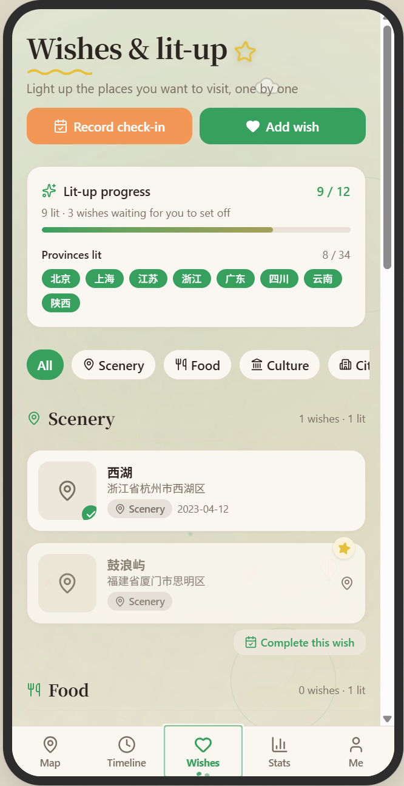 |

| Stats | Me |
|---|---|
| 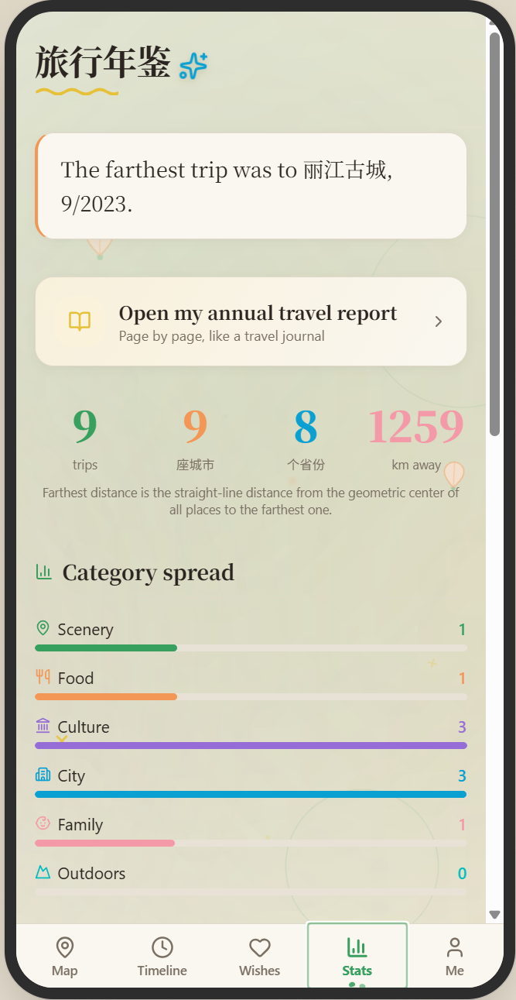 | 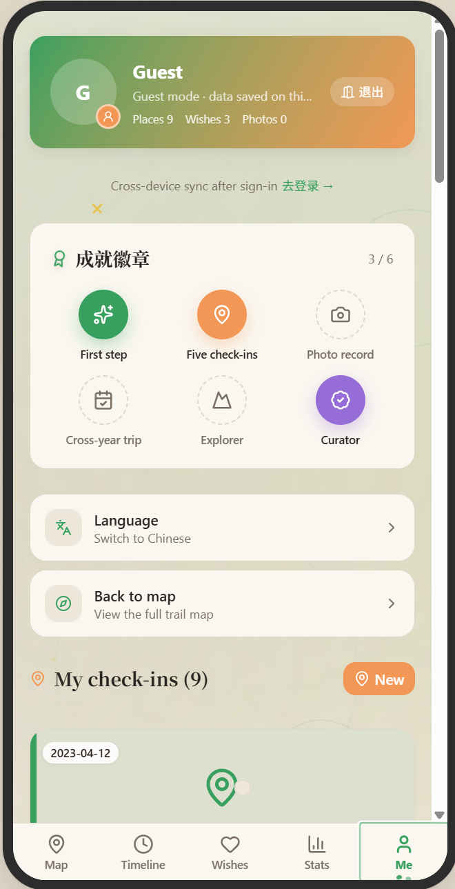 |

> 界面以公网部署为准。

## 快速开始

```bash
# 1. 安装依赖（前端为唯一应用层）
cd frontend && pnpm install

# 2. 配置环境变量
cp .env.example .env   # 填入 CloudBase 环境标识等（见下）

# 3. 启动开发模式（:5173）
pnpm dev

# 生产构建 + 本地预览（:4173）
pnpm build
pnpm preview --host 0.0.0.0 --port 4173

# 运行单元测试
pnpm test
```

> 本项目**没有独立后端服务**：前端通过 CloudBase JS SDK 直连云端（PostgreSQL + RLS + 对象存储），业务逻辑全部在前端完成。

### 环境变量（前端 `frontend/.env`）

| 变量 | 说明 |
|---|---|
| `VITE_CLOUDBASE_ENV_ID` | CloudBase 环境 ID |
| `VITE_CLOUDBASE_REGION` | CloudBase区域 |
| `VITE_CLOUDBASE_PUBLISH_KEY` | 发布密钥 |
| `VITE_OAUTH_RELAY_URL` | 登录中继地址 |
| `VITE_AI_BASE_URL` / `VITE_AI_MODEL` | AI 文案生成的网关与模型（可选） |
| `VITE_AI_API_KEY` | AI 密钥。**注意：VITE_ 前缀会被打进浏览器包，任何用户可提取，请勿使用高权限/计费无上限的密钥** |

## 目录结构

```
frontend/
  src/
    pages/      各页面（Index 地图主页、Timeline、Stats、Wishlist、Me、Checkin*、Login、SharePage）
    components/ 外壳（AppShell/MobileFrame/BottomNav/BottomSheet）+ ErrorBoundary + UI 组件（shadcn/ui，脚手架生成，实际使用 16 个，其余为预留组件，不影响运行）
    lib/        cloudbase(云端SDK) / checkins(数据层) / guest(游客模式) / ai / tencent-lbs(地图) / auth / i18n + locales(zh,en)
docs/
  产品方案.md        方案推演文档（以 frontend/src 代码为准）
  product/features.md 产品功能说明
  screenshots/     实机截图
```

## 技术栈

- **前端**：React 19 + Vite 7 + TypeScript 5.9 + Tailwind v4 + shadcn/ui(Radix) + TanStack Query v5 + framer-motion v12
- **数据**：腾讯云 CloudBase —— Auth v2 + PostgreSQL（RLS 行级安全）+ 对象存储
- **地图**：腾讯位置服务 GL API
- **质量**：Vitest 单元测试；GitHub Actions 持续集成（类型检查 / 代码检查 / 单测 / 构建）
- **视觉**：糖果配色、季节粒子背景、动态时间线图标、玻璃拟态卡片

## 常见问题

- **地图不显示？** 腾讯地图 Key 需把当前访问域名加入白名单，否则定位/打卡点加载失败。
- **游客模式和登录有什么区别？** 游客数据只在本机 `localStorage`；登录后数据写入云端并按用户隔离（RLS）。
- **AI 文案生成失败？** 未配置 `VITE_AI_API_KEY` 时会提示未配置；配置后仍报错多为网关/模型参数问题。
- **如何切换语言？** 进入「我的」页，底部「语言」一项可在中文 / English 之间切换，即时生效。

## 更新日志

- **v1.1** — 中英双语(i18n)、全局错误兜底(ErrorBoundary)、单元测试(Vitest)接入、环境变量模板、持续集成(GitHub Actions)、视觉迭代（糖果配色 / 季节粒子背景 / 动态时间线图标）。
- **v1.0** — 首版：地图主页、打卡/心愿、时间线、统计、游客模式、登录、精选分享。

### 本页事实性陈述与代码依据（供复核）

| 陈述 | 依据 |
|---|---|
| 路由含 `/` `/timeline` `/stats` `/wishlist` `/me` `/checkin/new` `/checkin/:id` `/checkin/:id/edit` `/wish/new` `/login` `/share/:publicId` `/auth/callback` | `frontend/src/App.tsx` |
| 游客模式用 `localStorage`，key `tf_guest_checkins` | `frontend/src/lib/guest.ts` |
| 数据层前端直连 CloudBase（`db.from`/`rpc`），无独立后端 | `frontend/src/lib/checkins.ts`、`cloudbase.ts` |
| 中英双语经 i18n 抽取，设置页可切换 | `frontend/src/lib/i18n.ts`、`locales/{zh,en}.ts`、`Me.tsx` |
| 全局错误兜底 ErrorBoundary 包裹应用入口 | `frontend/src/components/ErrorBoundary.tsx`、`main.tsx` |
| 单元测试 Vitest，覆盖数据层纯函数 | `frontend/vitest.config.ts`、`src/lib/__tests__/*.test.ts` |
| 持续集成 GitHub Actions 跑 typecheck/lint/test/build | `.github/workflows/ci.yml` |
| 预览命令 `vite preview` 绑定 4173 | `frontend/package.json` `scripts.preview` |
| 地图用腾讯位置服务 GL | `frontend/src/lib/tencent-lbs.ts` |
